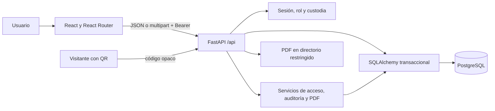

# Arquitectura técnica

Se mantiene la arquitectura existente. React 18 usa Vite para desarrollo/build y Vitest con jsdom para pruebas; el cambio de herramientas reemplaza CRA sin alterar la arquitectura de custodia ni la API. El cliente conserva compatibilidad con la variable de API heredada y recomienda `VITE_API_URL`. Los routers coordinan casos de uso, validación y transacciones. Las reglas compartidas están en servicios y dependencias. Las consultas simples usan SQLAlchemy directamente; una capa adicional de repositorios no aportaba valor suficiente en esta versión.

| Ubicación | Responsabilidad |
|---|---|
| `backend/app/api` | Endpoints y coordinación de casos de uso |
| `backend/app/schemas` | Contratos Pydantic y validación |
| `backend/app/models` | Persistencia y restricciones |
| `backend/app/core` | Sesiones, autorización de rol, almacenamiento |
| `backend/app/services` | Custodia, auditoría y PDF |
| `backend/migrations` | Alembic y conservación del legado |
| `backend/tests` | Validación aislada con datos sintéticos |
| `frontend/src/context` | Identidad y sesión de interfaz |
| `frontend/src/api` | Cliente HTTP y descarga autenticada |
| `frontend/src/components/Connected*` | Pantallas conectadas y formulario común |
| `frontend/src/components/shared` | Tabla, campos, paginación y estados |

## Integridad y transacciones

El email es único y las contraseñas se almacenan como hashes. La referencia documental es única por parroquia, tipo, libro, folio y número. Los NULL históricos permanecen pendientes de conciliación. Las FK protegen referencias; los listados filtran por custodia antes de paginar.

Las solicitudes permiten `pendiente → aprobada` o `pendiente → rechazada`; ambas decisiones son terminales. Una actualización condicionada por estado protege frente a decisiones repetidas incluso en SQLite. La corrección genera una nota con motivo, fecha, autor y valores anterior/posterior. Un certificado conserva la instantánea emitida.

El PDF adjunto usa nombre interno aleatorio bajo `UPLOAD_DIR`, tamaño máximo 10 MB y hash SHA-256 comprobado al descargar. La descarga siempre atraviesa la API autenticada.

## Sesiones, privacidad y errores

El JWT contiene sujeto, identificador de sesión, versión y caducidad. La sesión persistente permite revocar logout; cambios de acceso incrementan la versión para invalidar sesiones anteriores. Usuarios/parroquias inactivos son rechazados. Cinco fallos de cuenta conocidos activan bloqueo temporal de 15 minutos.

Las transacciones fallidas se revierten. La integridad produce 409 y los fallos de persistencia 503 sin SQL ni secretos. CORS usa orígenes explícitos. `no-store`, `nosniff` y política de referencia reducen exposición accidental, sin sustituir TLS. La verificación pública devuelve solo número, fecha y parroquia.

PostgreSQL es el destino institucional. SQLite sirve para desarrollo y pruebas aisladas; no se presume equivalencia completa de concurrencia. La aplicación no migra automáticamente al arrancar. El catálogo y el legado no se borran para adaptar el esquema.

Referencias técnicas oficiales: [JWT en FastAPI](https://fastapi.tiangolo.com/tutorial/security/oauth2-jwt/), [sesiones SQLAlchemy](https://docs.sqlalchemy.org/en/20/orm/session_basics.html), [migraciones por lotes Alembic](https://alembic.sqlalchemy.org/en/latest/batch.html). La evidencia específica del sistema está en las pruebas ejecutadas.

## RBAC y ciclo documental consolidado

La matriz de siete roles reside en core/roles.py y dependencias. Los predicados del contexto React permiten presentar acciones; FastAPI vuelve a validar toda operación. El auditor tiene control global de bitácoras/agregados, sin lectura general de identidades ni legado NULL. Secretario general y canciller disponen de lectura global explícita.

Certificados: preparado→autorizado→firmado para ordinarios; preparado→autorizado→aprobado_curia→firmado para competencia de Curia. Párroco custodio autoriza; el firmante es párroco en ordinario y canciller en Curia. Párroco custodio o canciller anula desde cualquier estado no anulado. Cada transición registra evento y usa bloqueo más actualización condicionada por estado, evitando dos actuaciones incompatibles concurrentes. Solo firmado es válido/descargable. La fecha_emision/emitido_por histórica corresponde a la preparación técnica; las fechas y autores de las actuaciones están separados.
